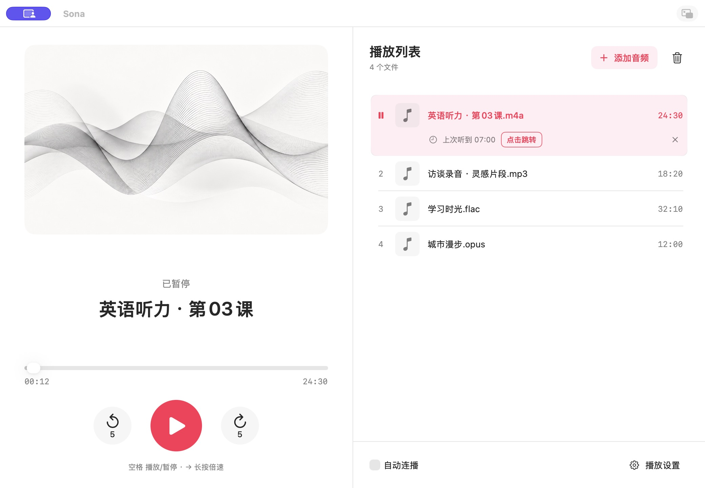
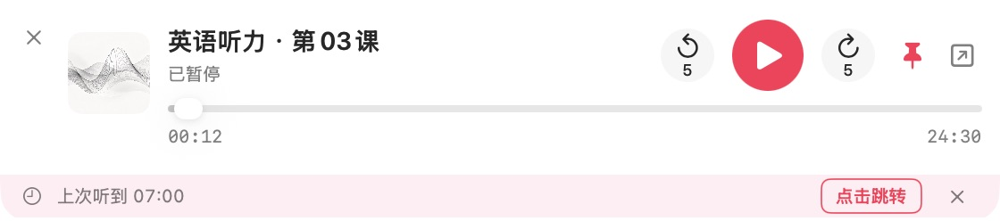
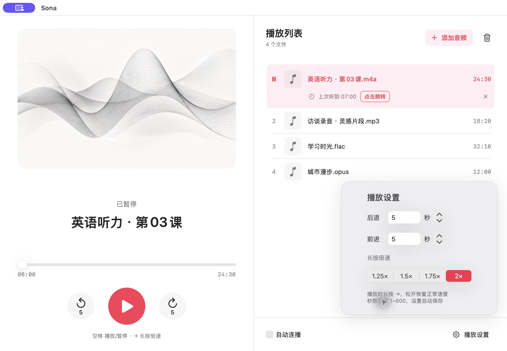
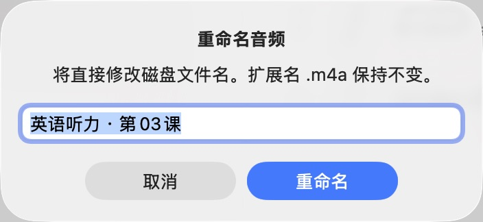
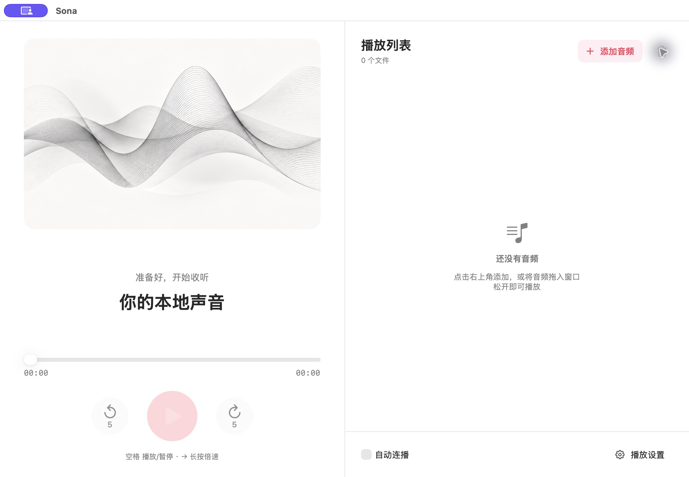

# Sona

Sona 是一款轻巧的 macOS 本地音频播放器，无账号或联网播放功能。应用包含所需解码工具，使用时无需安装其他软件。

## 项目预览

实际 macOS 应用界面：左侧播放控制，右侧播放列表与每首音频的续听提示，支持多种本地音频格式与自动连播。



<details>
<summary>查看小窗模式：紧凑播放控制、置顶与续听提示</summary>




</details>

<details>
<summary>查看播放设置：自定义前进、后退秒数和长按倍速</summary>



</details>

<details>
<summary>查看文件重命名：直接修改磁盘文件名，保留扩展名</summary>



</details>

<details>
<summary>查看拖入播放入口：音频可直接拖入窗口</summary>



</details>

截图使用生成的示例音频文件，展示当前应用的实际运行效果。

## 使用

界面采用左侧正在播放、右侧播放列表的双栏布局。点击右下角“播放设置”可调整跳转秒数和长按倍速。

从 [Releases 下载最新版本](https://github.com/xc66xc/local-audio-player/releases/latest) 中的 `Sona-v版本号-macOS-arm64.zip`，解压后打开“Sona.app”。当前提供 Apple Silicon 版，未接入 Developer ID 签名或 Apple 公证，其他 Mac 从网络下载后可能被 Gatekeeper 阻止打开，详见对应 Release 说明。

从源码构建后，应用位于 `dist/Sona.app`。

Sona 原名“本地音频播放器”。更名后沿用原有应用标识和本机存储目录，播放列表、进度及设置会继续恢复；使用旧版的用户请先退出旧应用，再打开 Sona。

1. 点击“添加音频”（或 Command-O）选择本地音频；也可把 Finder、桌面或下载文件夹中的音频文件直接拖入窗口，松手后加入列表并播放。
2. 点击“播放”播放第一首；双击列表中的其他文件可切换播放。
3. 空格播放/暂停；← 后退，→ 短按快进（松开时跳转），前进/后退秒数可分别输入设置，范围 1–600 秒，默认各 5 秒。
4. 播放时按住 → 约 0.35 秒进入所选倍速（1.25×、1.5×、1.75× 或 2×），松开或切换窗口恢复正常速度，不额外快进。暂停时长按不会开始播放；设置自动保存。
5. 勾选“自动连播”后，当前音频正常播完会播放下一首；未勾选则停止。最后一首播完停止，不循环。
6. 垃圾桶按钮只从列表移除所选项，不删除磁盘上的文件。
7. 右键列表中的音频，选择“重命名…”，输入不含扩展名的新名称。这会直接修改原文件夹中的磁盘文件名，并更新列表与保存记录；扩展名保留，同名文件不会被覆盖。
8. 切回听过的音频时，当前列表行会提示“上次听到”。点击“点击跳转”回到上次位置，播放中继续播放、暂停时保持暂停；点击 × 或主动调整进度则采用这次的位置。
9. 点击主窗口右上角的小窗图标，或按 Command-Shift-M，切换到紧凑小窗；点小窗右上角的展开图标返回主界面。切换保持当前播放状态和进度，长按倍速会恢复正常速度。

小窗保留播放/暂停、自定义秒数前后跳、进度拖动、续听提示和文件拖入，空格与方向键操作一致，也可按 Command-O 添加音频。它默认置顶，可用图钉取消；展开后主窗口恢复普通层级。拖动缩略图或其左侧空白区域可移动小窗。窗口模式、各自位置与置顶偏好自动保存，下次启动仍恢复进度并保持暂停。点击小窗 × 会保存并退出 Sona；播放列表管理、重命名和播放设置在主界面操作。

拖入会把新文件追加到现有列表末尾，一次拖入多个文件时按文件名排序，播放本次拖入的第一首候选；后续按现有列表顺序和“自动连播”开关处理。相同路径不会重复添加：拖入当前曲目时继续原进度，拖入其他已有曲目时切换并从头播放。文件夹、网页链接和不支持的文件会被跳过并汇总提示；首个候选无法打开时报告错误并保留原播放，不逐首试播整批。

拖动悬停不会打断正在播放的音频。读取较慢时可取消；之后手动播放、暂停、跳转、列表操作或再次拖入会使旧批次失效，迟到结果不会抢播。选择文件或重命名弹窗打开期间暂不接收拖入。音频文件保留在原位置，应用只保存引用；目前接收已有本地文件，不导入临时文件承诺或自动下载远程音频。

支持 MP3（CBR/VBR）、M4A（AAC/ALAC）、AAC/ADTS、WAV（PCM/浮点）、FLAC、AIFF/AIF、OGG（Vorbis/Opus）、Opus，并支持未加密的 M4B 和 CAF（PCM）。相同扩展名可以包含不同编码；损坏文件、不支持的编码及 DRM 加密内容会提示无法播放，APE、WMA、DSD 暂不在支持范围内。

OGG/Opus 使用内置的 FFmpeg 精简工具进行本地流式解码，其余使用系统播放器。流式路径保持少量 PCM 缓冲，不生成整首解码缓存；支持相同的跳转、临时倍速和自动连播。列表时长取自实际文件。

默认不自动连播。关闭窗口停止播放并退出；播放列表及顺序、上次播放的音频与进度、自动连播开关和播放设置均自动保存。下次打开恢复到上次位置并保持暂停，点击播放或按空格后继续。已播完的音频恢复在结尾，再次播放从头开始。手动快进到结尾不会自动切歌。

每首列表音频保存一个续听位置。切歌或自动连播仍从头开始，可通过提示跳回旧位置；提示中的旧断点不会被刚从头播放的几秒覆盖，未处理就切走或退出也会保留。重启时同时恢复本次实际进度和未处理的提示。主动跳转、关闭提示，或播放追上旧位置后，开始记录本次进度。少于 5 秒和已播完的音频不显示续听提示；重命名保留记录，从列表移除时清理。文件被替换或旧位置超出新时长时，不使用失效的断点。

播放过程中约每 5 秒保存一次断点，暂停、跳转、切歌和设置更改也会保存，正常退出前保存最新状态。强制退出或崩溃后可能回退到最近一次成功保存的位置。文件移动或删除后会保留条目；不可用条目可点击“重新定位”，或右键选择重新定位/移除。重新定位会保留条目顺序，并按新文件时长校正进度。

记录仅保存在本机 `~/Library/Application Support/local.miniaudio.player/`，列表引用与每首音频的续听位置保存在 `session.json`，当前实际进度、设置与待选提示保存在小文件 `transport.json`，避免周期性重写全部文件书签与续听表；不复制音频、不上传。旧版记录会自动迁移，其他音频从首次收听后开始积累续听位置。记录损坏时会尝试备份并提示；无法保存时也会提示。旧版程序无法读取新版记录时会保留原文件并停止写入。

## 构建与测试

需要 macOS、Swift 5.9 或更新版本的编译工具，以及系统的 make、curl、tar。首次构建会下载并校验固定版本的 FFmpeg 源码，编译仅含 Ogg 解码与 PCM 输出的本地工具，后续复用 `.build/decoder`；不包含网络协议。测试另需含 libvorbis、libopus、libmp3lame 编码器的 `ffmpeg` 来生成合成样本；它不是应用的运行依赖。新版 Homebrew 的基础 ffmpeg 不含 libvorbis，可安装 `brew install ffmpeg-full`，然后用 `PATH="$(brew --prefix ffmpeg-full)/bin:$PATH" bash test.sh` 运行测试。

```sh
bash build-app.sh
bash test.sh
```

脚本生成适用于当前编译机器架构的 `.app`，使用本机临时签名，不含开发者签名和公证。当前构建为 Apple Silicon 版本。部署目标为 macOS 13，旧系统兼容性需要在对应系统另行验证。

自动测试生成合成音频，覆盖 AAC/ALAC、MP3 CBR/VBR、AAC ADTS、24 位/浮点 WAV、FLAC、AIFF、M4B、CAF、Vorbis/Opus，以及跳转、暂停、倍速、正常结束与自动连播、损坏文件、过期回调和键盘事件，以及拖入即播、批量排序与去重、异步乱序/取消/超时、实际文件重命名、同名不覆盖、改名后跳转和断点恢复、每首音频的续听提示与旧断点保护、跨次启动恢复、文件重新定位、备份/版本迁移与校验、周期保存与写入失败。小窗测试覆盖窗口模式与位置恢复、置顶层级、播放与续听状态延续、长按释放及拖入回调；实际窗口另行检查布局、快捷键和切换。持久化测试使用独立临时目录与偏好域，不读取用户音频或真实播放记录。

## 贡献与许可

主分支为 `main`。改动在短期功能分支开发并提交 commit，通过 PR 审查后合入。外部开发者可以 Fork 后提 PR，具体见 [贡献指南](CONTRIBUTING.md)。

本项目采用 [MIT 许可证](LICENSE)。构建产物和测试音频不提交到 Git；应用分发使用 GitHub Releases。

应用随附独立的 [FFmpeg](https://ffmpeg.org/) 8.1.2 精简工具，采用 LGPL 2.1 或更新许可，不启用 GPL/nonfree 组件。许可证位于应用 `Contents/Resources/FFmpeg-LICENSE.txt`；对应未修改源码 `ffmpeg-8.1.2.tar.xz` 随 [Releases](https://github.com/xc66xc/local-audio-player/releases/latest) 提供，完整构建选项和校验值见 [build-decoder.sh](build-decoder.sh)。应用自身源码继续采用 MIT。

## 发布

`VERSION` 是唯一版本来源：修复增加修订号（1.0.1），兼容功能增加次版本（1.1.0），不兼容变化增加主版本（2.0.0）。只改文档或开发配置时不单独发版。

更新版本号通过 PR 合入 main，等待 CI 成功后，在干净且已同步的 main 上执行：

```sh
git switch main
git pull --ff-only
VERSION="$(cat VERSION)"
git tag -a "v$VERSION" -m "Release v$VERSION"
git push origin "v$VERSION"
```

Tag 必须是递增的新版本。推送后 GitHub Actions 自动验证主分支来源、运行测试、打包并发布 ZIP 与校验文件，发布说明根据 PR 自动生成。已发布的 Tag 禁止修改或删除。

本地打包和校验使用 `bash build-app.sh --package`，无需额外发布辅助脚本。

## ☕ 赞赏支持

| 支付宝 | 微信支付 |
| :---: | :---: |
|  |  |

> 本项目免费开源。如果它对你有帮助，欢迎自愿赞赏，支持后续维护。不论赞赏与否，都感谢你的支持与使用！
